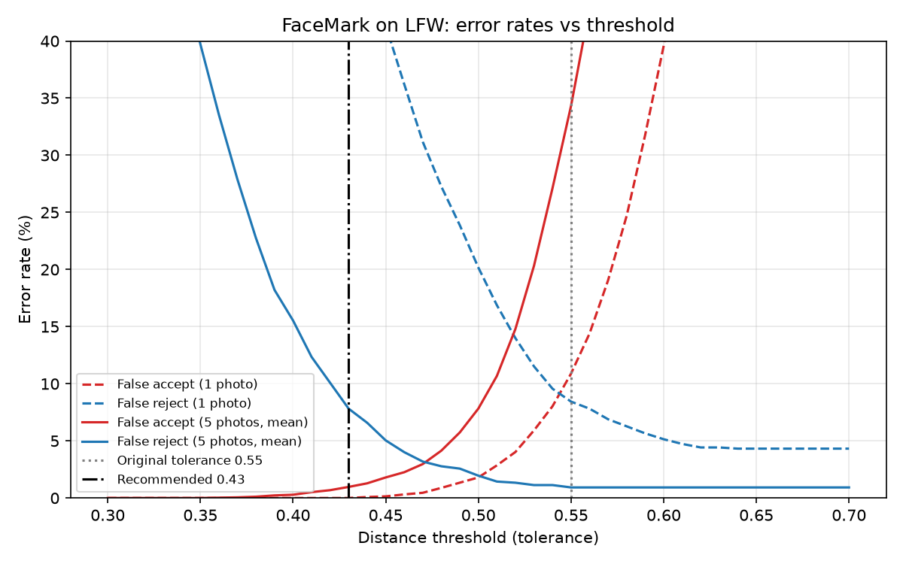

# FaceMark benchmarks

Every number here comes from the scripts in this folder and can be reproduced with the commands below. Raw outputs are in `results/`.

```bash
.venv/bin/python benchmarks/eval_recognition.py   # accuracy on LFW (downloads ~190 MB once, ~2 min on 7 cores)
.venv/bin/python benchmarks/eval_performance.py   # speed (add --webcam to use real camera frames)
.venv/bin/python benchmarks/eval_system.py        # DB latency (needs MySQL loaded with schema.sql)
```

Machine: Apple M1 (8 cores), CPU only, Python 3.13, dlib 20.0.1, face_recognition 1.3.0.

## 1. Recognition accuracy (LFW)

**Protocol.** This is an attendance-style open-set test on Labeled Faces in the Wild (5,749 people, 13,233 photos).
- **Enrolled:** 119 identities with 10+ photos act as enrolled students.
- **Strangers:** 39 more such identities, plus 1,000 people with 2–9 photos, act as strangers walking past the camera. That gives 1,039 impostor identities.
- **Probes:** 972 genuine probes (other photos of the enrolled students) and 3,500 impostor probes.
- **Matching:** probes go through the app's own `FaceMatcher` (`face_matching.py`).
- **Detection:** no face was detected in 0.3% of photos (HOG detector).

| Setup | Rank-1 accuracy | At original tolerance 0.55: identified / stranger accepted | EER | Best threshold with stranger-accept ≤ 1% |
|---|---|---|---|---|
| **Original: 1 photo per student** | 95.68% | 91.56% / **10.89%** | 8.80% | 0.48 → 72.74% identified |
| 3 photos, nearest photo | 98.46% | 97.63% / 17.60% | 5.25% | 0.46 → 84.16% |
| 3 photos, averaged (mean) | 99.28% | 98.97% / 28.89% | 3.60% | 0.44 → 88.68% |
| 5 photos, nearest photo | 98.56% | 98.05% / 21.74% | 4.39% | 0.44 → 84.88% |
| **New default: 5 photos, averaged** | **99.07%** | 99.07% / 34.31% | **3.08%** | **0.43 → 92.18%** (FAR 0.97%, wrong-student 0.10%) |

**Multi-frame confirmation** uses the new default at 0.43. A student is marked only if M probes in a row match the same person.

| M | Identified | Stranger accepted (FAR) | Marked as wrong student |
|---|---|---|---|
| 1 | 92.18% | 0.97% | 0.10% |
| 2 | 85.78% | 0.32% | 0.00% |
| **3 (default)** | 79.74% | **0.14%** | 0.00% |



**What changed and why:**
- **The original 0.55 tolerance is too loose for a classroom.** With 1 photo per student, 10.9% of strangers get matched to some enrolled student. The original "96% accuracy" is really the closed-set rank-1 number (95.7%), which assumes everyone in front of the camera is enrolled.
- **Averaging 5 enrollment photos fixes the trade-off.** The EER drops 65% (8.8% → 3.1%). At under 1% false accepts, the share of students correctly identified rises from 72.7% to 92.2%.
- **Averaging makes distances smaller**, which is why the tuned threshold is tighter (0.43). Don't use 0.43 with only 1 photo per student: identification drops to 47.6%. Use 0.48 for single-photo enrollment.
- **Requiring 3 matching frames in a row cuts false accepts about 7× more** (0.97% → 0.14%). These probes are independent photos, so this is an upper bound. Consecutive webcam frames are correlated, so the real gain is smaller. The lower per-sequence identification rate also overstates the real cost, because a student stays in front of the camera for many frames and only needs any 3 in a row.

## 2. Speed (live pipeline)

Synthetic 1280×720 frames with an LFW face about 220 px wide, a gallery of 60 enrolled students, and 40 frames per setting. These are medians.

| Pipeline | Detect | Encode | Match | Total / frame | FPS |
|---|---|---|---|---|---|
| HOG, full resolution | 416.7 ms | 13.0 ms | 0.08 ms | 433.2 ms | 2.3 |
| HOG, ½ scale | 104.8 ms | 12.3 ms | 0.08 ms | 117.5 ms | 8.5 |
| **HOG, ¼ scale (app default)** | 30.2 ms | 14.6 ms | 0.09 ms | **45.6 ms** | **21.9** |
| CNN detector, ¼ scale | 189.4 ms | 12.6 ms | 0.08 ms | 201.6 ms | 5.0 |
| HOG, ¼ scale, 2 faces | 26.3 ms | 24.0 ms | 0.07 ms | 50.4 ms | 19.9 |

All settings detected 100% of the faces at this face size.

- **Downscaling frames 4× before detection is 9.5× faster** (433 → 46 ms). Detection dominates (about 66% of frame time), not matching.
- **The CNN detector is 4.4× slower than HOG on CPU.** It is more robust to angles, but it only makes sense with a GPU.
- **Frame skipping:** running recognition on every 2nd frame (`FRAME_SKIP=2`) raises loop throughput from 24.9 to 52.5 frames/s. That comfortably keeps up with a 30 FPS webcam.
- **Matching scales linearly and stays cheap:** 0.009 ms at 24 students, 0.16 ms at 1k, 1.6 ms at 10k, 16 ms at 100k. A vector index (e.g. FAISS) only becomes worth it above roughly 100k students.

Caveat: these frames are synthetic. Faces smaller than about 160 px in a 720p frame (people far from the camera) fall below the HOG detector's minimum after ¼ downscaling. Run with `--webcam` to measure your own camera.

## 3. Database

300 queries against a local MySQL 9.7 (`results/system.json`):

| | Median | p95 |
|---|---|---|
| New connection per query (original code style) | 4.68 ms | 15.53 ms |
| **Pooled connection (`DatabaseManager`)** | **0.91 ms** | 2.27 ms |

That is 5.2× lower latency per query. Marking attendance runs 4 queries, so the database cost per student stays under 4 ms.

## Glossary (for explaining these numbers)

- **Rank-1 accuracy:** if we always pick the closest enrolled student, how often is it the right one. It ignores strangers.
- **FAR (false accept rate):** fraction of strangers marked present as someone. This is the proxy-attendance risk.
- **FRR (false reject rate):** fraction of enrolled students not marked, or marked as someone else.
- **EER (equal error rate):** the threshold where FAR = FRR. It summarizes the whole trade-off in one number; lower is better.
- **Threshold / tolerance:** the maximum embedding distance that counts as a match. Lowering it trades FRR for FAR.
